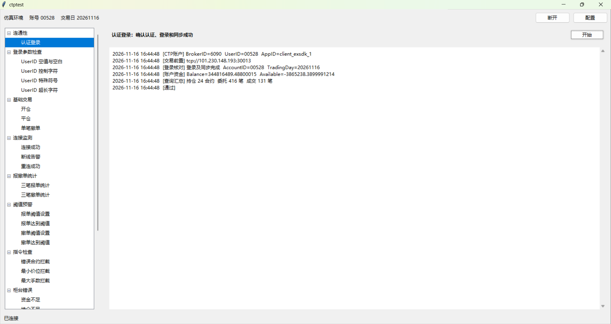

# ctptest

基于 [exsdk](https://skyzhi.com/) 的开源 CTP 程序化交易测试工具，提供 Windows 图形界面，支持开平撤单、连接监测、柜台错误及持续报单测试。



## 运行

Windows x64、Python 3.14（含 Tkinter）。在项目根目录执行：

```powershell
python -m venv .venv
.\.venv\Scripts\python.exe -m pip install --upgrade -r requirements.txt
.\.venv\Scripts\python.exe -m pip install -e .
.\.venv\Scripts\ctptest.exe
```

## 使用

1. 准备 CTP 仿真账号、接入参数和 [Token](https://skyzhi.com/login)。
2. 在“配置”中填写账号、Token、交易前置、主合约和买卖价格，保存后点击“连接”。
3. 连接成功后选择测试点，点击“开始”，查看回报并使用系统工具截图。

内置 29 个测试点。参数可在配置中调整。

## 注意事项

- 使用专用仿真账号；交易测试会发送真实请求，停止或退出不会自动平仓或撤销全部委托。
- 价格由用户设置，不依赖行情；开平仓每笔一手，资金不足测试默认 100 手。
- 重开工具会清空上次测试记录，请提前保存截图和日志。对外分享时请脱敏。
- 测试结论以实际回报为准，验收要求以期货公司要求为准。

## 贡献与许可

欢迎提交 [Issue](https://github.com/skyzhi-tech/ctptest/issues) 或 Pull Request，请附版本信息、复现步骤及脱敏日志。

本项目采用 [MIT 许可证](LICENSE)。exsdk 适用其自身的使用条款。
